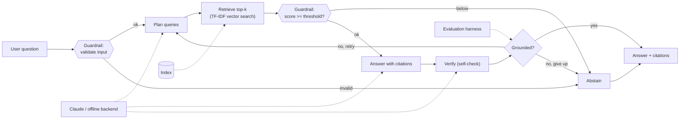

# 🔎 GroundedRAG — a Retrieval-Augmented, Self-Checking Q&A System

## Title and Summary

**GroundedRAG** answers questions about a collection of documents. Instead of
trusting a language model's memory, it **retrieves** the most relevant passages,
**answers only from those passages with citations**, and then **verifies its own
answer** before showing it to you. When the documents don't support an answer,
it says so rather than guessing.

This matters because plain language models *hallucinate* (invent facts), go
*stale* (their training has a cutoff date), and can't *show their sources*.
GroundedRAG is a small, transparent, and reliable implementation of the standard
industry fix — Retrieval-Augmented Generation (RAG) — hardened with an agentic
self-check loop, safety guardrails, and a measurable evaluation harness. It runs
with **Claude (`claude-opus-4-8`)** when an API key is available, and **fully
offline** with a deterministic backend otherwise, so anyone can clone it and run
it with no key and no setup friction.

---

## My Original Project (Modules 1–3)

My original project was the **Music Recommender Simulation** (model name
*"Mood Catcher 1.0"*). It represented songs and a user "taste profile" as data
and used a transparent, rule-based scoring function to recommend songs: each
track earned points for matching the listener's favorite genre and mood and for
how close its energy was to the listener's target, and the top-scoring songs were
returned **with a plain-English reason for every pick**. Its guiding goals were
*transparency over accuracy* and *explaining why* each recommendation was made,
rather than optimizing for engagement like a real streaming service.

**How GroundedRAG builds on it.** Both systems are, at heart, *similarity-ranking
engines that prioritize explainability*: the recommender scored songs by how
closely they matched a taste profile; GroundedRAG scores document passages by how
closely they match a question (cosine similarity over TF-IDF vectors), returns
the top matches, and — like the recommender's "reasons" — attaches a **citation**
to every claim so the user can see exactly *why* an answer was given. GroundedRAG
extends those ideas into a full applied-AI system by adding a real large language
model, an agentic self-verification loop, safety guardrails, and a formal
evaluation harness.

---

## Architecture Overview

The full system diagram is in
[`diagrams/architectures.mmd`](diagrams/architectures.mmd). At a high level, a
question flows left-to-right through a multi-step **agentic pipeline** and comes
back as a grounded, cited answer — or a safe abstention:



The pieces and how data moves between them:

1. **Ingestion (offline, run once).** Documents in `data/docs/` (`.md`/`.txt`/
   `.pdf`) are loaded, split into overlapping **chunks**, vectorized with
   **TF-IDF**, and saved to a persisted **index** (`index/`).
2. **The agentic pipeline** (`src/ragqa/pipeline.py`) — the core advanced AI
   feature. A single question runs through: **(1) input guardrail →
   (2) plan** (turn the question into focused search queries) **→ (3) retrieve**
   the top-k most similar chunks **→ (4) retrieval guardrail** (abstain if
   nothing is relevant enough) **→ (5) answer** using only those chunks, with
   citations **→ (6) verify** that every claim is grounded in the cited chunks
   **→ (7) retry or abstain** if it isn't.
3. **The model backend** (`src/ragqa/llm.py`) is swappable: **Claude** via the
   Anthropic Messages API with structured JSON outputs, or a **deterministic
   offline backend** (extractive answers + lexical grounding checks) that needs
   no key or network.
4. **Cross-cutting concerns**: **logging** to console and `logs/ragqa.log`; an
   **evaluation harness** that runs a gold Q&A set through the pipeline; a
   **test suite**; and **human review** of metrics/traces to curate documents
   and tune thresholds.

---

## Setup Instructions

Requires **Python 3.10+**.

```bash
# 1. Enter the project
cd applied--ai-system-project2

# 2. Create and activate a virtual environment
python -m venv .venv
source .venv/bin/activate        # macOS/Linux
# .venv\Scripts\activate         # Windows

# 3. Install dependencies
pip install -r requirements.txt

# 4. Build the retrieval index from data/docs (run once, or after changing docs)
python -m src.ragqa.cli ingest

# 5. Ask a question
python -m src.ragqa.cli ask "What does TF-IDF stand for?"
```

Other commands (also available via the `Makefile`, e.g. `make demo`):

```bash
python -m src.ragqa.cli demo     # canned end-to-end demo (3 answerable + 1 out-of-scope)
python -m src.ragqa.cli eval     # run the evaluation harness and print metrics
pytest                           # run the offline test suite (27 tests)
streamlit run app_streamlit.py   # optional web UI
```

**Configuration is optional.** Every setting has a safe default, so the app runs
with no configuration at all (in offline mode). To use Claude instead, copy
`.env.example` to `.env` and set `ANTHROPIC_API_KEY` — **no code changes
needed**. Key settings: `RAGQA_BACKEND` (`auto`/`anthropic`/`offline`),
`RAGQA_MODEL`, `RAGQA_TOP_K`, `RAGQA_MIN_SCORE` (abstention threshold).

**Use your own documents:** drop `.md`/`.txt`/`.pdf` files into `data/docs/`,
re-run `ingest`, and ask away.

---

## Sample Interactions

These are real outputs from the offline backend (abridged for readability).

### 1. A grounded, cited answer

```
$ python -m src.ragqa.cli ask "What does TF-IDF stand for?"

Q: What does TF-IDF stand for?

TF-IDF stands for Term Frequency-Inverse Document Frequency. [1] ... TF-IDF is
a sparse, transparent representation that needs no training data and no model
downloads, which makes it easy to run locally and fully reproducible. [1]

Sources:
  [1] vector_search.md (score 0.239)

backend=offline · grounded=True · abstained=False · attempts=1 · top_retrieval_score=0.239
```

### 2. Answering a conceptual question, still grounded in the sources

```
$ python -m src.ragqa.cli ask "How does self-verification make a RAG system more reliable?"

Q: How does self-verification make a RAG system more reliable?

Self-verification is a step in which the system checks its own output before
returning it. [1] In a RAG system, a verification step confirms that the
generated answer is grounded in the cited passages; if it is not, the system
can retry the retrieval or abstain. [1]

Sources:
  [1] guardrails.md (score 0.242)
  [2] rag.md (score 0.145)

backend=offline · grounded=True · abstained=False · attempts=1 · top_retrieval_score=0.242
```

### 3. Safe abstention on an out-of-scope question

```
$ python -m src.ragqa.cli ask "Who won the 2022 FIFA World Cup?"

Q: Who won the 2022 FIFA World Cup?

I don't have enough information in the provided documents to answer that.

backend=offline · grounded=False · abstained=True · attempts=1 · top_retrieval_score=0.000
```

The third question isn't covered by the documents, so retrieval scores fall
below the threshold and the system **abstains instead of hallucinating** — the
core safety behavior this project is built to demonstrate.

---

## Design Decisions and Trade-offs

- **Agentic self-verification over a single model call.** The pipeline plans,
  answers, *and then checks its own answer* against the sources, retrying or
  abstaining if it isn't grounded. This is the feature that makes it *reliable*
  rather than just *fluent*. **Trade-off:** more model calls (higher latency and
  cost) per question.
- **Local TF-IDF vector search instead of a hosted embedding API.** This keeps
  the whole system reproducible and offline — no downloads, no extra keys — while
  still demonstrating real vector search. **Trade-off:** TF-IDF is *lexical*, so
  a question phrased very differently from the source text can retrieve poorly.
  A dense-embedding retriever could be swapped in behind the same interface.
- **Two interchangeable backends (Claude + deterministic offline).** The same
  pipeline drives both, so the project is impressive *and* reproducible: a
  grader with no API key can still run everything and pass every test.
  **Trade-off:** the offline backend's answers are extractive (stitched from
  source sentences), so they read less fluently than Claude's.
- **Abstention as a first-class outcome.** A retrieval-score threshold and a
  grounding check both allow the system to refuse. **Trade-off:** the threshold
  is tuned for the bundled corpus and may need adjusting for a very different
  document set (`RAGQA_MIN_SCORE`).
- **Structured (JSON-schema) outputs from Claude** so responses are reliably
  parseable rather than free text that needs brittle parsing.

---

## Testing Summary

The project ships **27 automated tests** (`pytest`) plus an **evaluation
harness** (`python -m src.ragqa.cli eval`) that scores the pipeline against a
gold Q&A set.

**What worked.** All 27 tests pass. They cover chunking, retrieval ranking and
persistence, the offline backend, every pipeline guardrail, the agentic
retry/abstain loop, and the evaluation harness — and they run **fully offline**,
so they're reproducible on any machine. On the bundled corpus the harness reports
**100% abstention accuracy, 100% groundedness, 100% retrieval hit rate, and
88% keyword recall.**

**What didn't (at first) — and what I learned.**

- A **configuration bug**: I set a new default abstention threshold on the config
  dataclass, but a separate `load_config()` function was still hard-coding the
  old value, so the change silently had no effect. The failing evaluation test
  (an out-of-scope question that *should* have been refused was being answered)
  is what surfaced it. **Lesson:** an evaluation harness catches behavioral
  regressions that unit tests on individual functions miss.
- The **88% keyword recall** (not 100%) is itself a finding, not a failure. On
  one question the extractive *offline* backend stitches together the most
  query-overlapping sentences and misses the single most distinctive term. Rather
  than hide it by editing the gold set, I left it visible — it's exactly the kind
  of weakness an evaluation harness exists to surface, and it largely disappears
  with the Claude backend, which writes a genuine answer instead of extracting.

The broader lesson: **measuring** an AI system's behavior — especially its
failure and refusal behavior — is as important as building it.

---

## Reflection

Building this taught me that a reliable AI system is less about a single clever
model call and more about the *scaffolding around it*: retrieval to ground the
answer, guardrails to catch bad inputs and weak evidence, a self-check to verify
the output, and an evaluation harness to prove it all works. The hardest and most
valuable behavior to get right was teaching the system to say **"I don't know"** —
abstaining is what separates a trustworthy assistant from a confident liar.

> **Note:** My full, graded responsible-AI reflection — how I collaborated with
> AI, one helpful and one flawed AI suggestion, and my system's limitations —
> is in [`model_card.md`](model_card.md).

---

## Project Structure

```
applied--ai-system-project2/
├── README.md                 # this file
├── model_card.md             # responsible-AI reflection + model card
├── requirements.txt          # dependencies
├── .env.example              # copy to .env to configure
├── Makefile                  # convenience commands
├── diagrams/architectures.mmd# full Mermaid system diagram
├── data/
│   ├── docs/                 # knowledge base (.md/.txt/.pdf) — swap in your own
│   └── eval/qa_eval.jsonl    # gold Q&A set for evaluation
├── src/ragqa/
│   ├── config.py             # env-driven configuration
│   ├── logging_setup.py      # console + file logging
│   ├── documents.py          # loading + chunking
│   ├── retriever.py          # TF-IDF vector search (+ persistence)
│   ├── prompts.py            # Claude prompt templates
│   ├── llm.py                # Anthropic + offline backends
│   ├── pipeline.py           # the agentic RAG workflow  ← core
│   ├── evaluation.py         # reliability/evaluation harness
│   └── cli.py                # ingest / ask / eval / demo
├── app_streamlit.py          # optional web UI
└── tests/                    # offline pytest suite (27 tests)
```

## Limitations and Future Improvements

- TF-IDF matches wording, not deeper meaning; a dense-embedding retriever could
  be added behind the same `TfidfRetriever` interface.
- The knowledge base is small and curated; answers are only as good as the docs.
- The retrieval threshold is tuned for the bundled corpus.
- **Future:** stream Claude's answer token-by-token; add an LLM-as-judge grader;
  cache planning/verification results to cut cost and latency.
