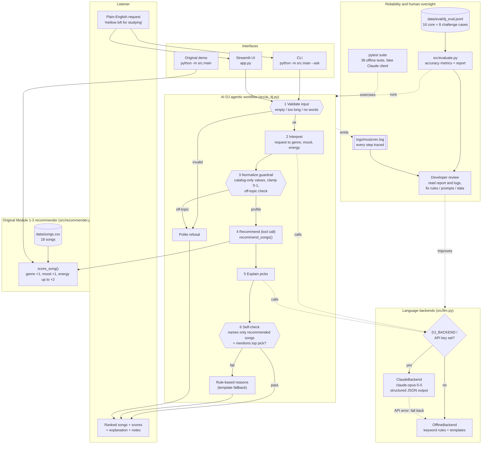

# 🎧 Mood Catcher AI DJ — a Music Recommender with an Agentic AI Layer

**Mood Catcher AI DJ** recommends songs from a plain-English request like
*"something mellow and chill to study to, lo-fi please."* An **agentic AI
workflow** interprets the request, calls the original rule-based recommender as
a tool, explains the picks, and **checks its own explanation** before showing
it. Guardrails reject bad input and off-topic requests, and every step is logged.

The project extends my **CodePath AI 110 Modules 1–3 Music Recommender
Simulation**. The original scoring engine still makes every ranking decision.
The AI handles only the language around it: understanding the request going in
and explaining the result coming out.

It runs with **Claude (`claude-opus-5-5`)** when an API key is configured, and
**fully offline** with a deterministic keyword parser when it isn't. Anyone can
clone it, run it, and pass every test without a key.

> 📹 **Demo video:** _add your walkthrough link here_

---

## Original Project (Modules 1–3)

The original project was the **Music Recommender Simulation ("Mood Catcher
1.0")**, a small, transparent, content-based recommender:

- **Data:** 18 songs in `data/songs.csv`, each with a genre, mood, and audio
  features (energy, valence, danceability, acousticness, tempo).
- **Input:** a taste profile typed into the code (`genre`, `mood`, `energy`).
- **Scoring:** `score_song()` gives **+1.0** for a genre match, **+1.0** for a
  mood match, and **up to +2.0** for how close a song's energy is to the target.
  These are the weights after my *Weight Shift* experiment; the starter used
  genre +2.0 and energy up to +1.0.
- **Output:** the top *k* songs, each with **a plain-English reason** for the pick.
- **Guiding goal:** *transparency over accuracy*. Every recommendation can be
  explained.

Its main limitations, documented in [`model_card.md`](model_card.md), were:
- Users had to type exact catalog values (`genre="pop"`).
- Exact string matching meant "pop" never matched "indie pop".
- The `Recommender` class was still a starter stub.

The original Module 3 README is kept at
[`docs/module3_original_README.md`](docs/module3_original_README.md).

## What's new in this version

| Area | Change |
|---|---|
| **AI feature** | `src/ai_dj.py`: an **agentic workflow** (validate → interpret → normalize → recommend → explain → self-check) that turns free text into a recommendation |
| **AI backends** | `src/llm.py`: **Claude** with structured JSON output, plus an **offline** keyword parser behind the same interface |
| **Guardrails** | Input validation, catalog-only profile values, energy clamping, off-topic refusal, and an explanation self-check that blocks invented song titles |
| **Reliability** | `src/evaluate.py` + `data/eval/dj_eval.jsonl` (24 labeled requests); **39 automated tests**, including a fake Claude client |
| **Logging** | Every step is written to `logs/musicrec.log`; warnings are also shown in the console |
| **Original code** | `Recommender.recommend()` / `explain_recommendation()` stubs finished by wrapping the existing `score_song()`; `load_songs()` errors now use logging; scoring logic **unchanged** |
| **Interfaces** | `python -m src.main` still runs the original demo; `--ask` adds the AI DJ; `app.py` is a Streamlit UI |

---

## Architecture

Source: [`diagrams/architecture.mmd`](diagrams/architecture.mmd). GitHub renders the copy below.



**How data moves through the system**

1. **Validate** (guardrail). The request is cleaned of control characters and
   rejected if it is empty, longer than 300 characters, or has no letters.
2. **Interpret** (AI). The backend maps the text to a taste profile.
   - Claude gets the catalog's allowed genres and moods as a JSON-schema `enum`,
     so it can only answer with values that exist in the catalog.
   - The offline backend uses keyword and synonym rules.
   - If Claude fails (bad key, network error, refusal, unusable output), the
     workflow **falls back to the offline parser** and records a note.
3. **Normalize** (guardrail). Values outside the catalog are dropped with a
   warning, energy is clamped to 0–1 (default 0.5), and off-topic requests are
   refused here.
4. **Recommend** (tool call). The profile goes to the **unchanged** original
   `recommend_songs()`, which scores and ranks every song.
5. **Explain** (AI). The backend writes a short explanation from the scores and reasons.
6. **Self-check.** The explanation must name the top pick and **no song that
   wasn't recommended**. If it fails, the user sees the rule-based reasons instead.

---

## Setup

Requires **Python 3.10+** (tested on Python 3.13.2, macOS).

```bash
# 1. Clone and enter the project
git clone https://github.com/aldaneeeee/applied--ai-system-project2.git
cd applied--ai-system-project2

# 2. Create and activate a virtual environment
python3 -m venv .venv
source .venv/bin/activate          # Windows: .venv\Scripts\activate

# 3. Install dependencies (anthropic, python-dotenv, streamlit, pytest)
pip install -r requirements.txt

# 4. (Optional) enable Claude: copy the template and paste your key into .env
cp .env.example .env
```

**Configuration (all optional, in `.env`):**

| Variable | Default | Meaning |
|---|---|---|
| `ANTHROPIC_API_KEY` | _(empty)_ | Your key from <https://console.anthropic.com/>. Without it the app runs offline. |
| `DJ_BACKEND` | `auto` | `auto` (Claude if a key is set), `claude` (always; clear error if no key), or `offline` |
| `DJ_MODEL` | `claude-opus-5-5` | The Claude model to use |

`.env` is listed in `.gitignore`, so your key is never committed.

## Running it

```bash
python -m src.main                                   # original Module 3 demo
python -m src.main --ask "upbeat happy pop for a road trip"
python -m src.main --ask "chill lofi for studying" -k 3 --trace   # show each agent step
python -m src.main --ask "..." --backend offline     # force a backend
python -m src.evaluate                               # reliability evaluation
pytest                                               # test suite (offline)
streamlit run app.py                                 # web UI
```

The `Makefile` has shortcuts: `make run`, `make ask Q="..."`, `make eval`, `make test`, `make ui`.

---

## Sample Interactions

These are real outputs from the **offline backend** (`--backend offline`, or no
key set). Long recommendation lists are shortened with `…`.

### 1. Natural-language request → grounded recommendation (with agent trace)

```
$ python -m src.main --ask "something mellow and chill to study to, lo-fi please" -k 3 --trace

Request: "something mellow and chill to study to, lo-fi please"
Interpreted as: genre=lofi, mood=chill, energy=0.3
==================================================

1. Library Rain
   Artist: Paper Lanterns
   Score:  3.90
   Reasons:
     - Genre match (+1.0)
     - Mood match (+1.0)
     - Energy similarity (+1.90)

2. Midnight Coding        … Score: 3.76
3. Spacewalk Thoughts     … Score: 2.96
==================================================

DJ says (template): I looked for lofi songs, a chill mood, energy around 0.30. Top pick:
"Library Rain" by Paper Lanterns (score 3.90: Genre match (+1.0), Mood match (+1.0),
Energy similarity (+1.90)). Also try: "Midnight Coding", "Spacewalk Thoughts".

[backend=offline · status=ok]

Agent trace:
  {"step": "validate", "ok": true, "chars": 52}
  {"step": "interpret", "source": "offline", "on_topic": true, "genre": "lofi", "mood": "chill", "energy": 0.3, ...}
  {"step": "normalize", "ok": true, "profile": {"genre": "lofi", "mood": "chill", "energy": 0.3}, "warnings": []}
  {"step": "recommend", "k": 3, "top": [["Library Rain", 3.9], ["Midnight Coding", 3.76], ["Spacewalk Thoughts", 2.96]]}
  {"step": "verify", "passed": true, "reason": "explanation only references recommended songs", "source": "template"}
```

### 2. Synonyms map to catalog values ("rap" → hip hop, "confident" → triumphant)

```
$ python -m src.main --ask "rap music that makes me feel confident" -k 3

Request: "rap music that makes me feel confident"
Interpreted as: genre=hip hop, mood=triumphant, energy=0.85

1. Concrete Kings   (Ravi Stax)        Score: 4.00  - Genre match (+1.0), Mood match (+1.0), Energy similarity (+2.00)
2. Sunrise City     (Neon Echo)        Score: 1.94  - Energy similarity (+1.94)
3. Carnival Heat    (Los Girasoles)    Score: 1.92  - Energy similarity (+1.92)

[backend=offline · status=ok]
```

### 3. Guardrails: off-topic refusal and an honest "I couldn't match that"

```
$ python -m src.main --ask "Write my history essay for me"

Request: "Write my history essay for me"

I'm a music DJ, so I can only help with song requests. Try something like
"upbeat pop for a road trip" or "calm lofi for studying".

[backend=offline · status=out_of_scope]
```

```
$ python -m src.main --ask "polka music for my grandma" -k 3

Request: "polka music for my grandma"
Interpreted as: genre=None, mood=None, energy=0.5
1. Velvet Hours … 2. Delta Lament … 3. Harvest Wind …
Note: No energy level detected; using a neutral 0.5.
Note: I couldn't match a genre or mood from the catalog, so these picks are ranked by energy only.
```

### 4. Failure handling: Claude unavailable

Run with an **invalid** key against the real API. Claude returns 401, and the
workflow falls back to offline instead of crashing:

```
$ ANTHROPIC_API_KEY=sk-ant-invalid DJ_BACKEND=claude python -m src.main --ask "happy pop" -k 2

WARNING | Interpretation failed on claude backend: Claude rejected the API key (check ANTHROPIC_API_KEY).
Request: "happy pop"
Interpreted as: genre=pop, mood=happy, energy=0.5
1. Sunrise City … 2. Rooftop Lights …
DJ says (template-fallback): I looked for pop songs, a happy mood, energy around 0.50. Top pick: "Sunrise City" ...
Note: AI interpretation failed (Claude rejected the API key ...); used the offline parser.
[backend=claude · status=ok]
```

Forcing Claude with **no** key stops with a clear message (exit code 2):
`Error: ANTHROPIC_API_KEY is not set; use DJ_BACKEND=offline or add a key to .env.`

The original demo (`python -m src.main`) still prints the same five
recommendations as before: *Sunrise City 3.96, Rooftop Lights 2.92, Gym Hero
2.74, Concrete Kings 1.90, Night Drive Loop 1.90*.

---

## Design Decisions and Trade-offs

- **The AI is a layer around the recommender, not a replacement.** Claude never
  ranks songs; `score_song()` does. This keeps the original project's
  *transparency over accuracy* goal: every pick still has a numeric, explainable
  reason. **Trade-off:** the AI can't fix a weak scoring rule. It can only send
  a better profile into it.
- **An agentic workflow with fixed steps, not an open-ended agent.** The code
  decides the order of steps, and the model fills in two of them. That is
  easier to test, log, and explain than letting a model decide which tools to
  call. **Trade-off:** less flexible (for example, it can't ask a follow-up
  question).
- **Structured output with the catalog as an `enum`.** Claude must answer in a
  JSON schema whose genre and mood fields only allow values from `songs.csv`.
  This addresses the "pop vs. indie pop" exact-matching limitation from Module 3.
  The normalize step still re-checks every value, in case the backend misbehaves.
- **Self-check on the explanation.** The main risk of an AI explanation is a
  confident mention of a song that wasn't recommended, or doesn't exist in the
  catalog at all. The verify step checks that before anything is shown, and
  falls back to the rule-based reasons. **Trade-off:** it checks song titles,
  not every claim in the text.
- **Two interchangeable backends.** The offline backend makes the project
  reproducible: no key, no cost, deterministic tests. It also serves as the
  fallback when Claude fails. **Trade-off:** it understands only phrases it has
  rules for (see the challenge results below).
- **Model choice.** `claude-opus-5-5` with `effort: "low"` (both tasks are
  short). The request also opts into Anthropic's server-side refusal fallback
  (`fallbacks: "default"`). `DJ_MODEL` lets you switch to a cheaper model such
  as `claude-haiku-5-5`.

---

## Testing Summary

### Automated tests: `pytest` → **39 passed**

```
$ pytest
.......................................                                  [100%]
39 passed in 1.22s
```

| File | What it covers |
|---|---|
| `tests/test_recommender.py` | The original 2 starter tests, plus a new test that puts the best song **last** to prove the ranking really sorts (the old stub passed by luck) |
| `tests/test_ai_dj.py` | Input guardrails, profile guardrails (invented genre/mood dropped, energy 7.5 → 1.0), fallback when interpretation fails, **hallucinated-song detection**, explanation must mention the top pick, and the full trace |
| `tests/test_llm.py` | Offline parser cases, and the **Claude backend with a fake client**: request shape (model, schema `enum`, `<request>` tags), JSON parsing, refusal / `max_tokens` / connection errors → `LLMError`, and backend selection |
| `tests/test_evaluation.py` | The eval set is well formed, every core case passes, and off-topic requests are never answered |

### Reliability evaluation: `python -m src.evaluate`

The evaluation runs 24 labeled requests through the full workflow. **Core**
cases (16) were written alongside the offline rules and must pass. **Challenge**
cases (8) were written *after* the rules, deliberately using phrasing the rules
don't cover, and the rules were **not** tuned afterwards.

```
AI DJ evaluation  (backend=offline, 24 cases)

  [core]  16/16 cases fully passed
    Status accuracy          16/16  100%
    Genre accuracy            9/9   100%
    Mood accuracy            10/10  100%
    Energy in range           7/7   100%
    Top-3 hit rate           12/12  100%
    Explanation self-check   13/13  100%

  [challenge]  3/8 cases fully passed
    Status accuracy           6/8   75%
    Genre accuracy            1/2   50%
    Mood accuracy             1/2   50%
    Energy in range           2/3   67%
    Explanation self-check    5/5   100%
```

**What the challenge failures show (offline backend):**
- **Negation:** "not sad, I want happy songs" → *melancholic*. The parser takes the first mood word it sees.
- **Context:** "background music for a dinner **party**" → *euphoric*, energy 0.9.
- **Idioms with no rule:** "feeling blue", "get hyped" (only "hype" is listed), "loud guitars". The first two were refused as off-topic.

These are exactly the cases a language model should handle better. They are the
reason the Claude backend exists.

> **Claude backend results: not yet measured.** This repo was built and tested
> without an API key. The Claude code path is covered by fake-client tests, and
> its error handling was checked against the real API with an invalid key
> (example 4). To measure it, add a key and run
> `python -m src.evaluate --backend claude`. A full run makes about 40–45 API
> calls: one per non-blank request, plus one explanation per answered request.

---

## Reflection

**Key design takeaway:** the most useful place for AI in this recommender was
not the ranking. The rule-based ranking was already transparent and worked. The
useful places were the two *language* boundaries: understanding what a person
means, and explaining the result back to them. Guardrails, a self-check, and
fallbacks around the AI let it be added without losing the explainability that
was the point of the original project.

The biggest lesson was that a perfect score can mean the test is too easy. The
first evaluation came back 100%, which felt like success until it was clear the
test cases and the keyword rules had been written together. Adding challenge
cases written afterwards dropped the score to 3/8 and showed exactly where the
offline parser breaks: negation, context, and slang. The same thing happened in
my original code. The starter `Recommender` test passed even though the method
never sorted anything, purely because of the order of the test data. Both times,
the bug only showed up once the test was designed to fail if the code was wrong.

What surprised me was how little of the "AI" needed to be AI. The ranking was
already good and explainable, so the model only had to translate words in and
explain results out. Most of the reliability work was ordinary code around it:
input checks, catalog-only values, a self-check on the explanation, and
fallbacks. If I did it again, I'd write the evaluation cases *before* the
rules, and I'd spend effort on a bigger, more balanced song catalog. Many
requests are understood correctly but still have no good song to match.

The full responsible-AI reflection (limitations, biases, misuse, and how I
collaborated with AI) is in [`model_card.md`](model_card.md). The agent's
step-by-step behavior is documented in [`ai_interactions.md`](ai_interactions.md).

---

## Project Structure

```
applied--ai-system-project2/
├── README.md                  # this file
├── model_card.md              # model card + responsible-AI reflection
├── ai_interactions.md         # agent steps, tool calls, AI collaboration log
├── requirements.txt / .env.example / Makefile / pytest.ini
├── app.py                     # Streamlit UI
├── data/
│   ├── songs.csv              # original 18-song catalog
│   └── eval/dj_eval.jsonl     # 24 labeled requests (16 core + 8 challenge)
├── diagrams/architecture.mmd  # Mermaid system diagram
├── src/
│   ├── recommender.py         # ORIGINAL scoring engine (stubs finished, logic unchanged)
│   ├── main.py                # CLI: original demo, --ask, --eval
│   ├── ai_dj.py               # agentic workflow + guardrails + self-check
│   ├── llm.py                 # Claude + offline backends
│   ├── evaluate.py            # reliability evaluation
│   └── logging_setup.py       # console + logs/musicrec.log
├── tests/                     # 39 offline tests
├── docs/module3_original_README.md
└── archive/grounded-rag/      # earlier unrelated RAG prototype, kept for reference only
```

## Limitations and Future Work

- The catalog is still 18 songs across 15 genres, so many requests can only be
  matched on energy. **The biggest improvement would be more data**, not more AI.
- The offline parser misses negation, context, and idioms (see the challenge results).
- The self-check verifies song titles, not every factual claim in an explanation.
- **Next:** measure the Claude backend on the eval set; give partial credit for
  related genres in `score_song()`; use `likes_acoustic`, valence, and
  danceability in scoring.
